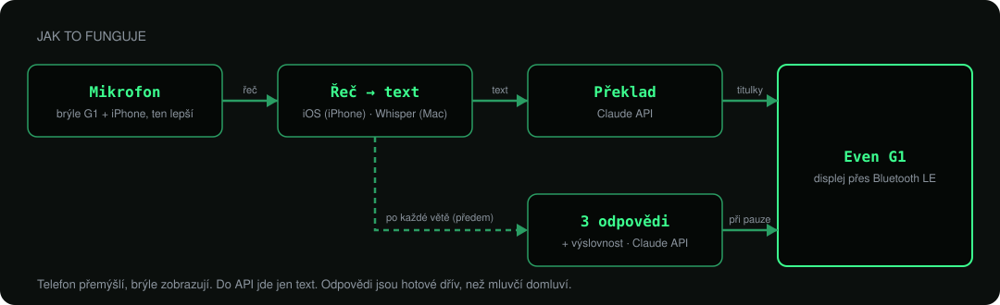
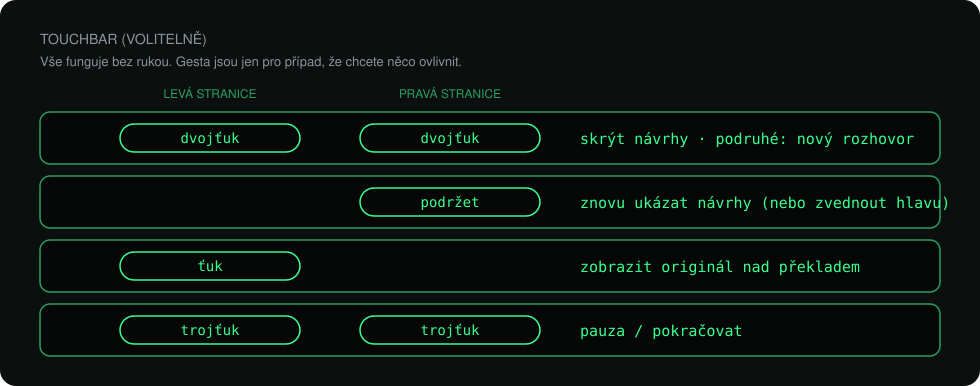

<div align="center">

# Even G1 Live Translator

**Překlad řeči v reálném čase s návrhy odpovědí pro chytré brýle Even Realities G1**

[](https://www.python.org/)
[](#požadavky)
[](LICENSE)
[](https://www.evenrealities.com/g1)

[English](README.md) · **Čeština**

</div>

---

Někdo na vás mluví jazykem, který neznáte – španělsky, anglicky, německy, čímkoli.
Brýle **Even Realities G1** ukazují **živý překlad do češtiny**, u první věty napíší, **jakým jazykem**
mluví, a jakmile domluví, nabídnou **tři odpovědi v jeho jazyce** – nahoře česky, co říkáte, pod tím
**výslovnost**, takže odpověď stačí přečíst nahlas.

<p align="center"></p>

## Obsah

- [Funkce](#funkce)
- [Jak to funguje](#jak-to-funguje)
- [Aplikace pro iPhone](#-aplikace-pro-iphone)
- [Požadavky](#požadavky)
- [Rychlý start](#rychlý-start)
- [Použití s brýlemi](#použití-s-brýlemi)
- [Ovládání](#ovládání)
- [Nastavení](#nastavení)
- [Jazyk](#jazyk)
- [Offline režim a náklady](#offline-režim-a-náklady)
- [Řešení potíží](#řešení-potíží)
- [Licence](#licence)

## Funkce

- 🌍 **Automatické rozpoznání jazyka** – zhruba 100 jazyků, přepne se samo, když začne mluvit někdo jiný jinou řečí.
- 💬 **Živý překlad** po větách, s ohledem na předchozí průběh rozhovoru.
- 🏷️ **Název jazyka** u první věty.
- 🙌 **Úplně bez rukou** – nic se neťuká, vše naskočí samo. TouchBar je jen volitelný.
- ✅ **Všechny tři návrhy odpovědí na jedné obrazovce**, když mluvčí domluví: *ano / souhlas*, *zdvořilé ne* a *doplňující otázka* (nebo „zopakujte to prosím pomaleji“, když řeč nebyla srozumitelná).
- 🗣️ **Výslovnost zapsaná česky** – nemusíte vědět, jak se cizí slova píšou.
- 🔁 **Rozhovor nevázne** – jakmile nahlas přečtete odpověď, brýle nabídnou, na co se zeptat vy: stejnou otázku zpátky („A ty?“) a dvě další rozumné otázky.
- ⚡ **Okamžité odpovědi** – návrhy se připravují na pozadí už po každé větě, takže naskočí hned, jak mluvčí přestane (≈ 1,5–2 s po posledním slově).
- 🙊 **Vaše řeč se nepřekládá** – čeština se ignoruje a aplikace pozná, když nahlas přečtete jeden z návrhů.
- 🔒 **Rozpoznávání řeči běží lokálně** na Macu (Whisper); k dispozici je i **úplně offline režim**.
- 🧪 **Simulátor v terminálu** – vývoj a testování bez brýlí.

## Jak to funguje

<p align="center"></p>

Aplikace komunikuje s G1 přímo přes **Bluetooth Low Energy** (Nordic UART, obě stranice) podle
oficiálního protokolu z [EvenDemoApp](https://github.com/even-realities/EvenDemoApp).

## 📱 Aplikace pro iPhone

Použití **bez notebooku**: nativní aplikace pro iPhone ve složce [`ios/`](ios) umí totéž – rozpoznávání řeči v iOS (zdarma, přímo v telefonu) + LLM API + displej G1. Jednou ji sestavíte v Xcode a pak běží v telefonu, i se zamčenou obrazovkou. Návod je v [ios/README.md](ios/README.md) (anglicky).

## Požadavky

- **macOS** s Bluetooth (ideálně čip Apple Silicon kvůli rychlému lokálnímu přepisu)
- **Python 3.11+**
- Brýle **Even Realities G1** (pro simulátor nejsou potřeba)
- Jazykový model: API klíč **Anthropic** nebo **OpenAI**, případně **Ollama** pro úplný offline

## Rychlý start

```bash
git clone https://github.com/Thominho/even-g1-translator.git
cd even-g1-translator

python3 -m venv .venv && source .venv/bin/activate
pip install -e .
pip install mlx-whisper              # Apple Silicon  (Intel: pip install faster-whisper)

cp config.example.toml config.toml   # nastavte native_language = "cs", [llm] backend a model
export ANTHROPIC_API_KEY="..."       # nebo OPENAI_API_KEY – trvale do ~/.zshrc
```

Test překladu a odpovědí bez mikrofonu:

```bash
python -m g1preklad demo "¿Te gusta vivir en Paraguay?"
```

Celá aplikace se **simulovaným displejem** v terminálu (mikrofon Macu – pusťte si video v cizím jazyce):

```bash
python -m g1preklad run --sim
```

Při prvním spuštění macOS požádá o přístup k **mikrofonu** a **Bluetooth** a jednorázově se stáhne
model Whisper (~1,5 GB).

## Použití s brýlemi

1. **Zavřete aplikaci Even Realities** v telefonu – G1 přijme vždy jen jedno připojení.
2. Vyndejte brýle z pouzdra a nasaďte je.
3. Spusťte:

```bash
python -m g1preklad run
```

## Ovládání

<p align="center"></p>

Simulátor (napsat + Enter): `d` / `a` ťuk vpravo / vlevo · `aa` dvojťuk · `ttt` trojťuk · `H` podržet vpravo · `q` konec.

## Nastavení

Vše je v `config.toml` (viz [`config.example.toml`](config.example.toml)).

| Nastavení | Výchozí | Popis |
|---|---|---|
| `translator.replies` | `true` | Nabízet návrhy odpovědí |
| `translator.prefetch_replies` | `true` | Připravovat odpovědi na pozadí pro okamžité zobrazení |
| `translator.follow_up_questions` | `true` | Po vaší odpovědi nabídnout otázky, na co se zeptat |
| `translator.reply_layout` | `all` | `all` = všechny návrhy na jedné obrazovce, `one` = po jednom, střídají se samy |
| `translator.turn_end_s` | `1.5` | Ticho (s), po kterém mluvčí „domluvil“ |
| `translator.sentence_pause_s` | `0.7` | Pauza mezi větami – menší = rychlejší titulky |
| `translator.show_spelling` | `false` | Pod výslovností i psaná podoba odpovědi |
| `translator.native_language` | `en` | **Váš jazyk** – pro češtinu nastavte `"cs"` |
| `translator.ignore_languages` | `[]` | Další jazyky, kterým rozumíte (nepřekládají se) |
| `stt.backend` | `mlx-whisper` | `mlx-whisper`, `faster-whisper` nebo `openai` |
| `llm.backend` | `anthropic` | `anthropic`, `openai` nebo `ollama` |
| `audio.source` | `mac` | `mac` (mikrofon Macu/AirPods) nebo `glasses` (mikrofon G1, potřebuje [liblc3](https://github.com/google/liblc3)) |
| `glasses.chars_per_line` | `38` | Šířka řádku na displeji G1 |

## Jazyk

Výchozí je angličtina – pro češtinu nastavte v `config.toml`:

```toml
[translator]
native_language = "cs"
```

Pak se vše překládá do češtiny, čeština se ignoruje, výslovnost se píše českým pravopisem
a popisky v brýlích jsou česky. Funguje to stejně pro další jazyky (de, es, fr, sk, pl…).

## Offline režim a náklady

| Část | Výchozí | Cena |
|---|---|---|
| Rozpoznání řeči | Whisper, **lokálně** | Zdarma |
| Překlad + odpovědi | Cloudový LLM (rychlý, levný model) | Zlomky haléře až haléře za větu |
| Úplně offline | [Ollama](https://ollama.com) + `qwen2.5:7b` | Zdarma, nižší kvalita |

```bash
brew install ollama && ollama pull qwen2.5:7b
# config.toml →  [llm] backend = "ollama"   model = "qwen2.5:7b"
```

## Řešení potíží

| Potíž | Řešení |
|---|---|
| Brýle se nenajdou | Zavřete aplikaci Even / vypněte Bluetooth v telefonu; spusťte `python -m g1preklad -v run` |
| Divné zalomení řádků | Upravte `glasses.chars_per_line` |
| Titulky se zpožďují | Snižte `sentence_pause_s`, použijte menší model Whisper |
| Návrhy přichází moc brzo / pozdě | Upravte `turn_end_s` |
| Překládá okolní hluk | Zvyšte `audio.threshold` |
| Spojení vypadává | Snižte `glasses.heartbeat_s` |

> **Stav projektu:** první verze. Implementace BLE vychází z oficiální dokumentace protokolu,
> ale na skutečném hardwaru byla zatím testována jen omezeně. Hlášení chyb s výpisem `-v` vítám.

## Přispívání

Issues i pull requesty jsou vítané – hlavně zkušenosti z reálných brýlí, podpora dalších rodných
jazyků a testování na Linuxu / Windows.

## ⭐ Podpořte projekt

Pokud vám projekt pomohl domluvit se nebo vás zachránil z trapné chvíle v zahraničí,
**budu moc rád za hvězdičku** – pomůže, aby ho našli i další. Předem děkuji! 🙏

## Licence

[MIT](LICENSE)

*Projekt není spojen se společností Even Realities ani jí schválen. „Even Realities“ a „G1“ jsou ochranné známky příslušného vlastníka.*
