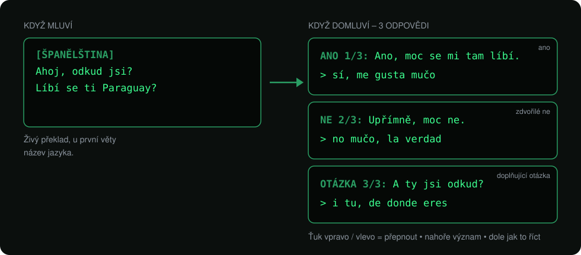

<div align="center">


# Even G1 Live Translator

**Překlad řeči v reálném čase s odpověďmi připravenými k vyslovení pro chytré brýle Even Realities G1**

[](ios)
[](#-aplikace-pro-mac)
[](LICENSE)
[](https://www.evenrealities.com/g1)
[](https://github.com/Thominho/even-g1-translator/stargazers)

⭐ *Pomohl vám projekt? Hvězdička pomůže, aby ho našli i další – děkuji!*

[🇬🇧 English](README.md) · **🇨🇿 Čeština** · [🇸🇰 Slovenčina](README.sk.md) · [🇩🇪 Deutsch](README.de.md) · [🇪🇸 Español](README.es.md)<br>
[🇫🇷 Français](README.fr.md) · [🇮🇹 Italiano](README.it.md) · [🇵🇹 Português](README.pt.md) · [🇵🇱 Polski](README.pl.md) · [🇳🇱 Nederlands](README.nl.md)

</div>

---

Někdo na vás mluví jazykem, který neznáte. Brýle **Even Realities G1** ukazují **živý překlad**,
u první věty napíší, **jaký je to jazyk**, a jakmile mluvčí domluví, nabídnou **tři odpovědi v jeho
jazyce** s výslovností. Jednu přečtete nahlas a brýle navrhnou, **na co se zeptat zpátky**. Chcete říct
něco jiného? **Řekněte to svým jazykem** a uvidíte to přeložené. Telefon zůstává v kapse.

<p align="center"></p>

## Obsah

- [Funkce](#funkce)
- [Jak to funguje](#jak-to-funguje)
- [📱 Aplikace pro iPhone](#-aplikace-pro-iphone) – doporučeno
- [Ovládání](#ovládání)
- [Volba jazyka](#volba-jazyka)
- [💻 Aplikace pro Mac](#-aplikace-pro-mac)
- [Náklady a soukromí](#náklady-a-soukromí)
- [Řešení potíží](#řešení-potíží)
- [Struktura projektu](#struktura-projektu)
- [Přispívání](#přispívání)

## Funkce

- 💬 **Živý překlad** po větách, s ohledem na dosavadní průběh rozhovoru.
- 🏷️ **Název jazyka** u první věty.
- ✅ **Tři odpovědi na jedné obrazovce**, když mluvčí domluví – *ano*, *zdvořilé ne*, *doplňující otázka* (nebo „zopakujte to prosím pomaleji").
- 🗣️ **Výslovnost psaná pro vás** – pravopisem vašeho jazyka.
- 🔁 **Rozhovor nevázne** – po vaší odpovědi brýle navrhnou, na co se zeptat zpátky (*„A ty?"* a dvě další rozumné otázky).
- 🎙️ **Řekněte cokoliv** – podržte levý TouchBar, řekněte to svým jazykem a uvidíte to v jeho jazyce i s výslovností.
- 🙌 **Bez rukou** – všechno naskočí samo, gesta jsou volitelná.
- 🎧 **Chytrý mikrofon** – poslouchá brýlemi G1 *i* iPhonem a použije ten, který mluvčího slyší lépe, s automatickým zesílením. Telefon může zůstat v kapse.
- ⚡ **Rychlost** – odpovědi i otázky se připravují na pozadí, takže naskočí hned, jak mluvčí přestane.
- 🙊 **Pozná vás** – váš jazyk se nikdy nepřekládá a aplikace pozná, když nahlas přečtete návrh.
- 🌍 **Váš jazyk** – překlady, výslovnost a popisky v brýlích v 10 jazycích (en, cs, sk, de, es, fr, it, pt, pl, nl); rozhraní aplikace ve stejných jazycích.

## Jak to funguje

<p align="center"></p>

Brýle jsou displej a mikrofony – přemýšlí telefon. Řeč se převádí na text v telefonu (rozpoznávání řeči
v iOS) nebo na Macu (Whisper); překlady, odpovědi a výslovnost dodává **Claude API** (ve výchozím
nastavení Claude Haiku – rychlý a levný). Aplikace komunikuje s G1 přímo přes **Bluetooth LE** podle
oficiálního protokolu z [EvenDemoApp](https://github.com/even-realities/EvenDemoApp).

## 📱 Aplikace pro iPhone

Nativní aplikace ve SwiftUI ve složce [`ios/`](ios) – vše běží v iPhonu, počítač při používání nepotřebujete.

**Instalace** (jednou, potřebuje Mac s Xcode – stačí obyčejné Apple ID):

```bash
brew install xcodegen
git clone https://github.com/Thominho/even-g1-translator.git
cd even-g1-translator/ios && xcodegen && open G1Translator.xcodeproj
```

V Xcode: **Signing & Capabilities** → vyberte svůj **Team** (Apple ID) a jedinečný **Bundle Identifier**,
zvolte svůj iPhone a klikněte na **▶ Run**. V iPhonu důvěřujte vývojářskému certifikátu
(*Nastavení → Obecné → VPN a správa zařízení*) a zapněte *Režim pro vývojáře*.

> S obyčejným Apple ID aplikace funguje **7 dní** – pak stačí připojit iPhone a znovu kliknout na Run.

**První spuštění** – v aplikaci otevřete *Nastavení*:

| Nastavení | |
|---|---|
| Mluví | Jazyk rozhovoru (rozpoznávání v iOS ho potřebuje znát předem) |
| Váš jazyk | Překlady, výslovnost a popisky v brýlích |
| Jazyk aplikace | Jazyk rozhraní – výchozí angličtina, 10 jazyků |
| API klíč | Z [Anthropic Console](https://console.anthropic.com); seznam modelů se načte sám, předvybraný je Claude Haiku |
| Mikrofon | **Automaticky** (lepší z brýlí a iPhonu), brýle G1, nebo iPhone / AirPods |
| Přesnější rozpoznávání (online) | Rozpoznávání na serverech Applu – v hluku přesnější, potřebuje internet |

Pak **zavřete aplikaci Even Realities** (G1 přijme vždy jen jedno připojení), nasaďte brýle a klepněte na **Spustit**.

## Ovládání

<p align="center"></p>

Zvednutím hlavy se návrhy ukážou znovu. V aplikaci pro iPhone jsou tytéž akce i jako tlačítka.

## Volba jazyka

Nastavte **Váš jazyk** (iPhone) nebo `native_language` (Mac). Řídí se jím všechno:

| | Co se mění |
|---|---|
| Překlad | Vše se překládá do vašeho jazyka |
| Ignorovaná řeč | Váš jazyk se nikdy nepřekládá |
| Výslovnost | Psaná pro vás – Angličan vidí `see, meh GOOS-tah`, Čech `sí, me gusta` |
| Řekni to | Diktujete svým jazykem |
| Popisky v brýlích | en, cs, sk, de, es, fr, it, pt, pl, nl (ostatní anglicky) |

Chybí váš jazyk? Přidejte ho v [`g1preklad/i18n.py`](g1preklad/i18n.py) a [`ios/G1Translator/I18n.swift`](ios/G1Translator/I18n.swift) – pull requesty vítám.

## 💻 Aplikace pro Mac

Původní verze v Pythonu – běží na Macu s Bluetooth a jazyk rozpozná sama (Whisper).

```bash
git clone https://github.com/Thominho/even-g1-translator.git && cd even-g1-translator
python3 -m venv .venv && source .venv/bin/activate
pip install -e . && pip install mlx-whisper      # Intel Mac: pip install faster-whisper
cp config.example.toml config.toml                # nastavte native_language = "cs"; výchozí Claude API s Claude Haiku
export ANTHROPIC_API_KEY="..."
python -m g1preklad demo "¿Te gusta vivir en Paraguay?"   # test bez mikrofonu
python -m g1preklad run --sim                            # simulovaný displej v terminálu
python -m g1preklad run                                  # s brýlemi
```

Hlavní nastavení v `config.toml`: `native_language`, `replies`, `follow_up_questions`, `reply_layout`,
`turn_end_s`, `prefetch_replies`, `[stt] backend`, `[llm] backend` (`anthropic`, `openai`, nebo `ollama`
pro úplný offline). Viz [`config.example.toml`](config.example.toml).

## Náklady a soukromí

| Část | Kde | Cena |
|---|---|---|
| Řeč → text | V iPhonu / na Macu (online rozpoznávání volitelně) | Zdarma |
| Překlad, odpovědi | Claude API (Claude Haiku) | Zlomky haléře až haléře za větu |
| Úplně offline (Mac) | Whisper + [Ollama](https://ollama.com) | Zdarma, nižší kvalita |

Do API jde jen text – zvuk se nikam neukládá. API klíč je uložený v Klíčence iOS.

## Řešení potíží

| Potíž | Řešení |
|---|---|
| Brýle se nenajdou | Zavřete aplikaci Even Realities; vyndejte brýle z pouzdra |
| Mluvčímu není rozumět | Mikrofon → *Automaticky* nebo *iPhone*, zapněte *Přesnější rozpoznávání (online)* |
| Návrhy přichází moc brzo / pozdě | Upravte *Pauzu před odpověďmi* |
| Divné zalomení řádků | Upravte *Znaků na řádek* |
| Aplikace po týdnu přestala fungovat | Limit obyčejného Apple ID – v Xcode znovu klikněte na ▶ Run |

> **Stav projektu:** první verze – sestavuje se a běží v iPhonu; testování s brýlemi v běžném provozu pokračuje.
> Hlášení chyb vítám.

## Struktura projektu

| Cesta | |
|---|---|
| [`ios/`](ios) | Aplikace pro iPhone (SwiftUI): Bluetooth G1, mikrofon brýlí (LC3 přes Google liblc3), rozpoznávání řeči, Claude API |
| [`g1preklad/`](g1preklad) | Aplikace pro Mac (Python): protokol, brýle, zvuk, Whisper, LLM |
| [`tests/`](tests) | Testy v Pythonu bez hardwaru: `python -m pytest` |
| [`docs/`](docs) | Ilustrace |

## Přispívání

Issues i pull requesty jsou vítané – hlavně zkušenosti z reálného používání, další jazyky a verze pro Android.

## ⭐ Podpořte projekt

Pokud vám projekt pomohl domluvit se nebo vás zachránil z trapné chvíle v zahraničí,
**budu moc rád za hvězdičku** – pomůže, aby ho našli i další. Předem děkuji! 🙏

## Licence

[MIT](LICENSE) · Dekodér LC3: Google liblc3 (Apache 2.0)

*Projekt není spojen se společností Even Realities ani jí schválen. „Even Realities" a „G1" jsou ochranné známky příslušného vlastníka.*
