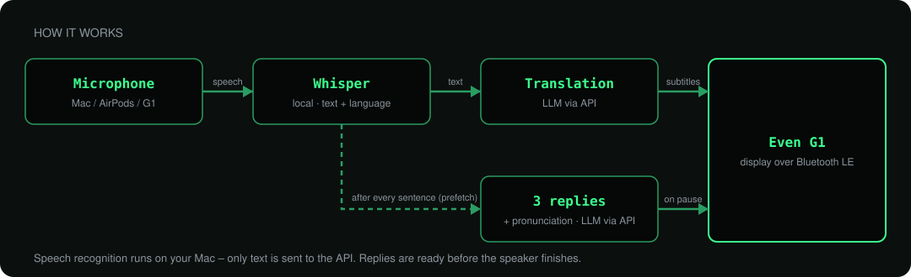

<div align="center">


# Even G1 Live Translator

**Echtzeit-Sprachübersetzung mit sprechfertigen Antworten für die Smart Glasses Even Realities G1**

[](ios)
[](README.md#-mac-app)
[](LICENSE)
[](https://github.com/Thominho/even-g1-translator/stargazers)

⭐ *Hat Ihnen das Projekt geholfen? Ein Stern hilft anderen, es zu finden – danke!*

[🇬🇧 English](README.md) · [🇨🇿 Čeština](README.cs.md) · [🇸🇰 Slovenčina](README.sk.md) · **🇩🇪 Deutsch** · [🇪🇸 Español](README.es.md) · [🇫🇷 Français](README.fr.md) · [🇮🇹 Italiano](README.it.md) · [🇵🇹 Português](README.pt.md) · [🇵🇱 Polski](README.pl.md) · [🇳🇱 Nederlands](README.nl.md)

</div>

---

Jemand spricht Sie in einer Sprache an, die Sie nicht können. Ihre **Even Realities G1** zeigt eine **Live-Übersetzung**, nennt beim ersten Satz **die Sprache** und bietet, sobald die Person fertig ist, **drei sprechfertige Antworten in ihrer Sprache** mit Aussprachehilfe. Lesen Sie eine vor – die Brille schlägt vor, **was Sie zurückfragen** können. Etwas anderes sagen? **Sagen Sie es in Ihrer Sprache** und sehen Sie es übersetzt. Das Handy bleibt in der Tasche.

<p align="center"></p>

## Funktionen

- **Live-Übersetzung** Satz für Satz, mit dem Gesprächsverlauf als Kontext.
- **Drei Antworten auf einem Bildschirm** – *Ja*, *höfliches Nein*, *Rückfrage*.
- **Aussprache für Sie geschrieben** – in der Schreibweise Ihrer Sprache.
- **Rückfragen** – nach Ihrer Antwort schlägt die Brille vor, was Sie fragen können.
- **Alles sagen** – linkes TouchBar halten und in Ihrer Sprache sprechen.
- **Freihändig, smartes Mikrofon** – G1-Brille und iPhone, das bessere wird genutzt.
- **10 Sprachen** – Übersetzung, Aussprache und App-Oberfläche.

<p align="center"></p>

## Loslegen

App für **iPhone** (empfohlen) und **Mac**. Die ausführliche Installations- und Einrichtungsanleitung steht im [englischen README](README.md#-iphone-app). Übersetzungen und Antworten kommen von der **Claude API** (Claude Haiku).

```bash
git clone https://github.com/Thominho/even-g1-translator.git
```

## Sprachen

Wählen Sie in den Einstellungen **Ihre Sprache** (Übersetzung, Aussprache, Brillenanzeige) und die **App-Sprache** (Oberfläche).

## ⭐ Projekt unterstützen

Wenn Ihnen das Projekt geholfen hat, sich zu verständigen, **freue ich mich über einen Stern** – so finden es auch andere. Vielen Dank im Voraus! 🙏

---

[MIT](LICENSE) · Nicht mit Even Realities verbunden oder von Even Realities unterstützt.
