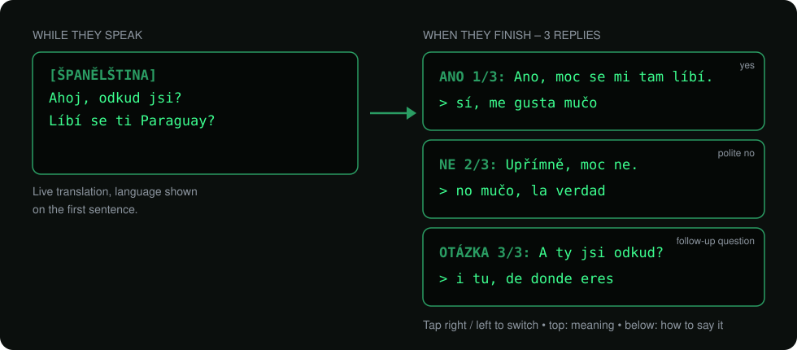

<div align="center">


# Even G1 Live Translator

**Echtzeit-Sprachübersetzung mit sprechfertigen Antworten für die Smart Glasses Even Realities G1**

[](ios)
[](#-mac-app)
[](LICENSE)
[](https://www.evenrealities.com/g1)
[](https://github.com/Thominho/even-g1-translator/stargazers)

⭐ *Hat Ihnen das Projekt geholfen? Ein Stern hilft anderen, es zu finden – danke!*

[🇬🇧 English](README.md) · [🇨🇿 Čeština](README.cs.md) · [🇸🇰 Slovenčina](README.sk.md) · **🇩🇪 Deutsch** · [🇪🇸 Español](README.es.md)<br>
[🇫🇷 Français](README.fr.md) · [🇮🇹 Italiano](README.it.md) · [🇵🇹 Português](README.pt.md) · [🇵🇱 Polski](README.pl.md) · [🇳🇱 Nederlands](README.nl.md)

</div>

---

Jemand spricht Sie in einer Sprache an, die Sie nicht können. Ihre **Even Realities G1** zeigt eine
**Live-Übersetzung**, sagt Ihnen, **welche Sprache** es ist, und bietet, sobald die Person fertig ist,
**drei sprechfertige Antworten in ihrer Sprache** mit Aussprachehilfe. Lesen Sie eine vor – die Brille
schlägt vor, **was Sie zurückfragen** können. Etwas anderes sagen? **Sagen Sie es in Ihrer Sprache** und
sehen Sie es übersetzt. Das Handy bleibt in der Tasche.

<p align="center"></p>

## Inhalt

- [Funktionen](#funktionen)
- [So funktioniert es](#so-funktioniert-es)
- [📱 iPhone-App](#-iphone-app) – empfohlen
- [Bedienung](#bedienung)
- [Sprache wählen](#sprache-wählen)
- [💻 Mac-App](#-mac-app)
- [Kosten und Datenschutz](#kosten-und-datenschutz)
- [Fehlerbehebung](#fehlerbehebung)
- [Projektstruktur](#projektstruktur)
- [Mitwirken](#mitwirken)

## Funktionen

- 💬 **Live-Übersetzung** Satz für Satz, mit dem bisherigen Gespräch als Kontext.
- 🏷️ **Sprachkennzeichnung** beim ersten Satz.
- ✅ **Drei Antworten auf einem Bildschirm**, sobald die Person fertig ist – *Ja*, *höfliches Nein*, *Rückfrage* (oder „Können Sie das langsamer wiederholen?“).
- 🗣️ **Aussprache für Sie geschrieben** – so, wie man sie in Ihrer Sprache liest.
- 🔁 **Hält das Gespräch am Laufen** – nach Ihrer Antwort schlägt die Brille Rückfragen vor (*„Und Sie?“* plus zwei sinnvolle Fragen).
- 🎙️ **Alles sagen** – linkes TouchBar halten, in Ihrer Sprache sprechen und es in der anderen Sprache mit Aussprache sehen.
- 🙌 **Freihändig** – alles erscheint von selbst; Gesten sind optional.
- 🎧 **Smartes Mikrofon** – hört mit der G1-Brille *und* dem iPhone und nutzt das, das die Person besser hört, mit automatischer Verstärkung. Das Handy kann in der Tasche bleiben.
- ⚡ **Schnell** – Antworten und Rückfragen werden im Hintergrund vorbereitet und erscheinen, sobald die Person verstummt.
- 🙊 **Erkennt Sie** – Ihre eigene Sprache wird nie übersetzt, und die App merkt, wenn Sie einen Vorschlag vorlesen.
- 🌍 **Ihre Sprache** – Übersetzungen, Aussprache und Brillenanzeige in en, cs, sk, de, es, fr, it, pt, pl, nl; App-Oberfläche in denselben 10 Sprachen.

## So funktioniert es

<p align="center"></p>

Die Brille ist Anzeige und Mikrofon – gedacht wird im Telefon. Sprache wird auf dem iPhone
(iOS-Spracherkennung) oder dem Mac (Whisper) in Text umgewandelt; Übersetzungen, Antworten und Aussprache
kommen von der **Claude API** (standardmäßig Claude Haiku – schnell und günstig). Die App spricht direkt
per **Bluetooth LE** mit der G1, nach dem Protokoll der offiziellen
[EvenDemoApp](https://github.com/even-realities/EvenDemoApp) von Even Realities.

## 📱 iPhone-App

Native SwiftUI-App in [`ios/`](ios) – alles läuft auf dem iPhone, während der Nutzung ist kein Computer nötig.

**Installation** (einmalig, benötigt einen Mac mit Xcode – eine kostenlose Apple-ID genügt):

```bash
brew install xcodegen
git clone https://github.com/Thominho/even-g1-translator.git
cd even-g1-translator/ios && xcodegen && open G1Translator.xcodeproj
```

In Xcode: **Signing & Capabilities** → Ihr **Team** (Ihre Apple-ID) und einen eindeutigen **Bundle Identifier** wählen,
Ihr iPhone auswählen und **▶ Run** drücken. Auf dem iPhone dem Entwicklerzertifikat vertrauen
(*Einstellungen → Allgemein → VPN und Geräteverwaltung*) und den *Entwicklermodus* aktivieren.

> Mit einer kostenlosen Apple-ID läuft die App **7 Tage** – dann das iPhone anschließen und erneut Run drücken.

**Erster Start** – öffnen Sie in der App *Einstellungen*:

| Einstellung | |
|---|---|
| Sie sprechen | Gesprächssprache (die iOS-Erkennung braucht sie im Voraus) |
| Ihre Sprache | Übersetzungen, Aussprache und Brillenanzeige |
| App-Sprache | Sprache der Oberfläche – standardmäßig Englisch, 10 Sprachen |
| API-Schlüssel | Aus der [Anthropic Console](https://console.anthropic.com); die Modellliste lädt automatisch, Claude Haiku ist vorausgewählt |
| Mikrofon | **Automatisch (besser)** (das bessere von Brille und iPhone), G1-Brille oder iPhone / AirPods |
| Bessere Erkennung (online) | Server-Erkennung von Apple – genauer bei Lärm, braucht Internet |

Dann **die Even-Realities-App schließen** (die G1 akzeptiert nur eine Verbindung), Brille aufsetzen und auf **Starten** tippen.

## Bedienung

<p align="center"></p>

Ein Blick nach oben zeigt die Vorschläge erneut. In der iPhone-App gibt es dieselben Aktionen als Tasten.

## Sprache wählen

Stellen Sie **Ihre Sprache** (iPhone) oder `native_language` (Mac) ein. Alles richtet sich danach:

| | Was sich ändert |
|---|---|
| Übersetzung | Alles wird in Ihre Sprache übersetzt |
| Ignorierte Sprache | Ihre eigene Sprache wird nie übersetzt |
| Aussprache | Für Sie geschrieben – Englischsprachige sehen `see, meh GOOS-tah`, Tschechischsprachige `sí, me gusta` |
| Sagen | Sie diktieren in Ihrer Sprache |
| Brillenanzeige | en, cs, sk, de, es, fr, it, pt, pl, nl (andere Sprachen nutzen Englisch) |

Ihre Sprache fehlt? Ergänzen Sie sie in [`g1preklad/i18n.py`](g1preklad/i18n.py) und [`ios/G1Translator/I18n.swift`](ios/G1Translator/I18n.swift) – Pull Requests willkommen.

## 💻 Mac-App

Die ursprüngliche Python-Version – läuft auf einem Mac mit Bluetooth und erkennt die Sprache automatisch (Whisper).

```bash
git clone https://github.com/Thominho/even-g1-translator.git && cd even-g1-translator
python3 -m venv .venv && source .venv/bin/activate
pip install -e . && pip install mlx-whisper      # Intel Mac: pip install faster-whisper
cp config.example.toml config.toml                # Standard: Claude API mit Claude Haiku
export ANTHROPIC_API_KEY="..."
python -m g1preklad demo "¿Te gusta vivir en Paraguay?"   # Test ohne Mikrofon
python -m g1preklad run --sim                            # simulierte Anzeige im Terminal
python -m g1preklad run                                  # mit der Brille
```

Wichtige Einstellungen in `config.toml`: `native_language`, `replies`, `follow_up_questions`, `reply_layout`,
`turn_end_s`, `prefetch_replies`, `[stt] backend`, `[llm] backend` (`anthropic`, `openai` oder `ollama`
für komplett offline). Siehe [`config.example.toml`](config.example.toml).

## Kosten und Datenschutz

| Teil | Wo | Kosten |
|---|---|---|
| Sprache → Text | Auf dem iPhone / Mac (Online-Erkennung optional) | Kostenlos |
| Übersetzung, Antworten | Claude API (Claude Haiku) | Bruchteile eines Cents pro Satz |
| Komplett offline (Mac) | Whisper + [Ollama](https://ollama.com) | Kostenlos, geringere Qualität |

An die API wird nur Text gesendet – es wird kein Audio gespeichert. Der API-Schlüssel liegt im iOS-Schlüsselbund.

## Fehlerbehebung

| Problem | Lösung |
|---|---|
| Brille wird nicht gefunden | Even-Realities-App schließen; Brille aus dem Etui nehmen |
| Person schlecht verständlich | Mikrofon → *Automatisch (besser)* oder *iPhone / AirPods*, *Bessere Erkennung (online)* einschalten |
| Vorschläge zu früh / zu spät | *Pause vor Antworten* anpassen |
| Zeilen brechen seltsam um | *Zeichen pro Zeile* anpassen |
| App läuft nach einer Woche nicht mehr | Grenze der kostenlosen Apple-ID – in Xcode erneut ▶ Run drücken |

> **Status:** frühe Version – lässt sich bauen und läuft auf dem iPhone; Tests mit echter Brille im Alltag laufen.
> Fehlerberichte sind sehr willkommen.

## Projektstruktur

| | |
|---|---|
| [`ios/`](ios) | iPhone-App (SwiftUI): G1-Bluetooth, Brillenmikrofon (LC3 über Google liblc3), Spracherkennung, Claude API |
| [`g1preklad/`](g1preklad) | Mac-App (Python): Protokoll, Brille, Audio, Whisper, LLM-Backends |
| [`tests/`](tests) | Python-Tests ohne Hardware: `python -m pytest` |
| [`docs/`](docs) | Illustrationen |

## Mitwirken

Issues und Pull Requests sind willkommen – besonders Erfahrungen aus der Praxis, weitere Sprachen und eine Android-Version.

## ⭐ Projekt unterstützen

Wenn Ihnen das Projekt geholfen hat, jemanden zu verstehen, oder Ihnen im Ausland einen peinlichen Moment erspart hat,
**freue ich mich über einen Stern** – so finden es auch andere. Vielen Dank im Voraus! 🙏

## Lizenz

[MIT](LICENSE) · LC3-Decoder: Google liblc3 (Apache 2.0)

*Nicht mit Even Realities verbunden oder von Even Realities unterstützt. „Even Realities“ und „G1“ sind Marken ihres jeweiligen Inhabers.*
