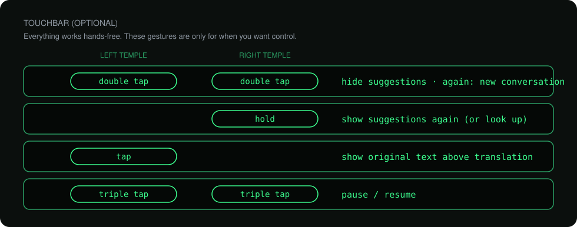

<div align="center">

# Even G1 Live Translator

**Real-time speech translation with smart reply suggestions for Even Realities G1 smart glasses**

[](https://www.python.org/)
[](#requirements)
[](LICENSE)
[](https://www.evenrealities.com/g1)

**English** · [Čeština](README.cs.md)

</div>

---

Someone speaks to you in a language you don't know – Spanish, English, German, anything.
Your **Even Realities G1** glasses show a **live translation**, tell you **which language** is being
spoken and, as soon as the speaker finishes, offer **three ready-to-say replies in their language**,
with a pronunciation guide so you can simply read them out loud.

<p align="center"></p>

> **Works in your language.** Set `native_language` to English, German, Spanish, French, Czech or
> any other language – translations, pronunciation spelling and the glasses UI follow it.
> See [Choosing your language](#choosing-your-language).

## Table of contents

- [Features](#features)
- [How it works](#how-it-works)
- [iPhone app](#-iphone-app)
- [Requirements](#requirements)
- [Quick start](#quick-start)
- [Using it with the glasses](#using-it-with-the-glasses)
- [Controls](#controls)
- [Configuration](#configuration)
- [Offline mode and costs](#offline-mode-and-costs)
- [Choosing your language](#choosing-your-language)
- [Project structure](#project-structure)
- [Troubleshooting](#troubleshooting)
- [Contributing](#contributing)
- [License](#license)

## Features

- 🌍 **Automatic language detection** – works with ~100 languages and switches on the fly when a different person speaks another language.
- 💬 **Live translation** sentence by sentence, using the conversation so far as context.
- 🏷️ **Language label** on the first sentence, so you always know what you're hearing.
- 🙌 **Completely hands-free** – no tapping, no buttons. Everything appears on its own; the TouchBar is optional.
- ✅ **All three reply suggestions on one screen** when the speaker finishes: *yes / agree*, *polite no*, and a *follow-up question* (or "could you repeat that more slowly?" when the speech was unclear).
- 🗣️ **Pronunciation guide** written for your native language – no need to know how the foreign words are spelled.
- 🔁 **Keeps the conversation going** – once you read a reply aloud, the glasses suggest questions to ask next: the same question back (*"And you?"*) plus two sensible follow-ups.
- ⚡ **Instant replies** – suggestions are prepared in the background after every sentence, so they appear the moment the speaker stops (≈ 1.5–2 s after the last word).
- 🙊 **Your own speech is ignored** – native-language speech is never translated, and the app recognises when you read one of the suggestions aloud.
- 🔒 **Speech recognition runs locally** on your Mac (Whisper); a **fully offline mode** is available with a local model.
- 🧪 **Terminal simulator** – develop and test without the glasses.

## How it works

<p align="center"></p>

The app talks to the G1 directly over **Bluetooth Low Energy** (Nordic UART, both temples), based on
Even Realities' official [EvenDemoApp](https://github.com/even-realities/EvenDemoApp) protocol.

## 📱 iPhone app

Use it **without a laptop**: a native iPhone app in [`ios/`](ios) does the same – iOS speech recognition (free, on-device) + the LLM API + the G1 display. Build it once with Xcode, then it runs on your phone, even with the screen locked. See the [iPhone guide](ios/README.md).

## Requirements

- **macOS** with Bluetooth (Apple Silicon recommended for fast local speech recognition)
- **Python 3.11+**
- **Even Realities G1** smart glasses (optional for the simulator)
- An LLM: an **Anthropic** or **OpenAI** API key, or **Ollama** for fully offline use

## Quick start

```bash
git clone https://github.com/Thominho/even-g1-translator.git
cd even-g1-translator

python3 -m venv .venv && source .venv/bin/activate
pip install -e .
pip install mlx-whisper              # Apple Silicon  (Intel: pip install faster-whisper)

cp config.example.toml config.toml   # then set [llm] backend and model
export ANTHROPIC_API_KEY="..."       # or OPENAI_API_KEY – add it to ~/.zshrc to keep it
```

Test the translation and replies without a microphone:

```bash
python -m g1preklad demo "¿Te gusta vivir en Paraguay?"
```

Run the full app with a **simulated display** in the terminal (uses your Mac microphone –
try playing a video in a foreign language):

```bash
python -m g1preklad run --sim
```

On the first run macOS asks for **microphone** and **Bluetooth** access for your terminal, and the
Whisper model (~1.5 GB) is downloaded once.

## Using it with the glasses

1. **Close the Even Realities app** on your phone – the G1 accepts only one connection at a time.
2. Take the glasses out of the case and put them on.
3. Run:

```bash
python -m g1preklad run
```

## Controls

<p align="center"></p>

Simulator keys (type + Enter): `d` / `a` tap right / left · `aa` double tap · `ttt` triple tap · `H` hold right · `q` quit.

## Configuration

All settings live in `config.toml` (see [`config.example.toml`](config.example.toml)).

| Setting | Default | Description |
|---|---|---|
| `translator.replies` | `true` | Offer reply suggestions |
| `translator.prefetch_replies` | `true` | Prepare replies in the background for instant display |
| `translator.follow_up_questions` | `true` | After your answer, suggest questions to ask back |
| `translator.reply_layout` | `all` | `all` = every suggestion on one screen, `one` = one per screen, rotating automatically |
| `translator.turn_end_s` | `1.5` | Silence (s) that ends the speaker's turn |
| `translator.sentence_pause_s` | `0.7` | Pause between sentences – lower means faster subtitles |
| `translator.show_spelling` | `false` | Show the written reply below the pronunciation |
| `translator.native_language` | `en` | **Your language** – see [Choosing your language](#choosing-your-language) |
| `translator.ignore_languages` | `[]` | Extra languages you understand (never translated) |
| `stt.backend` | `mlx-whisper` | `mlx-whisper`, `faster-whisper` or `openai` |
| `llm.backend` | `anthropic` | `anthropic`, `openai` or `ollama` |
| `audio.source` | `mac` | `mac` (Mac/AirPods mic) or `glasses` (G1 mic, needs [liblc3](https://github.com/google/liblc3)) |
| `glasses.chars_per_line` | `38` | Line width on the G1 display |

## Offline mode and costs

| Component | Default | Cost |
|---|---|---|
| Speech recognition | Whisper, **local** | Free |
| Translation + replies | Cloud LLM (fast, low-cost model) | Fractions of a cent per sentence |
| Fully offline | [Ollama](https://ollama.com) + `qwen2.5:7b` | Free, lower quality |

```bash
brew install ollama && ollama pull qwen2.5:7b
# config.toml →  [llm] backend = "ollama"   model = "qwen2.5:7b"
```

## Choosing your language

Set your native language in `config.toml`:

```toml
[translator]
native_language = "de"     # ISO 639-1 code: en, de, es, fr, it, pt, pl, nl, cs, sk, ja, …
```

| | What changes |
|---|---|
| **Translation** | Everything is translated into your language |
| **Ignored speech** | Your own language is never translated (add more with `ignore_languages`) |
| **Pronunciation** | Written with *your* spelling – an English speaker sees `see, meh GOOS-tah`, a Czech speaker `sí, me gusta` |
| **Glasses UI** | Labels in your language for en, cs, sk, de, es, fr, it, pt, pl, nl – other languages fall back to English, language names shown as endonyms (`[ESPAÑOL]`) |

Missing your language in the UI? Adding it is a few lines in
[`g1preklad/i18n.py`](g1preklad/i18n.py) – pull requests welcome.

## Project structure

| Path | Purpose |
|---|---|
| [`g1preklad/protocol.py`](g1preklad/protocol.py) | G1 BLE protocol – text (0x4E), microphone (0x0E), TouchBar events (0xF5), heartbeat |
| [`g1preklad/glasses.py`](g1preklad/glasses.py) | Connection to both temples (`bleak`) and the terminal simulator |
| [`g1preklad/audio.py`](g1preklad/audio.py) | Mac / G1 microphone (LC3), speech segmentation |
| [`g1preklad/ai.py`](g1preklad/ai.py) | Speech-to-text backends, LLM backends, prompts |
| [`g1preklad/i18n.py`](g1preklad/i18n.py) | Native language, UI labels, language names |
| [`g1preklad/app.py`](g1preklad/app.py) | Translator logic and command-line interface |
| [`tests/`](tests) | Tests that run without hardware: `python -m pytest` |

## Troubleshooting

| Problem | Fix |
|---|---|
| Glasses not found | Close the Even Realities app / turn off Bluetooth on your phone; run `python -m g1preklad -v run` |
| Lines wrap oddly | Adjust `glasses.chars_per_line` |
| Subtitles lag | Lower `sentence_pause_s`, use a smaller Whisper model |
| Suggestions appear too early / late | Adjust `turn_end_s` |
| Suggestions too long for one screen | Tune `glasses.chars_per_line`, or use `reply_layout = "one"` |
| Background noise gets translated | Raise `audio.threshold` |
| Connection drops | Lower `glasses.heartbeat_s` |

> **Project status:** early release. The BLE implementation follows the official protocol
> documentation but has had limited testing on real hardware. Bug reports with a `-v` log are appreciated.

## Contributing

Issues and pull requests are welcome – especially hardware test reports, UI translations for more
languages, and Linux / Windows testing.

## ⭐ Support the project

If this project helped you understand someone, or saved you an awkward moment abroad,
**please consider giving it a star** – it helps others find it. Thank you in advance! 🙏

## License

[MIT](LICENSE)

*Not affiliated with or endorsed by Even Realities. "Even Realities" and "G1" are trademarks of their respective owner.*
