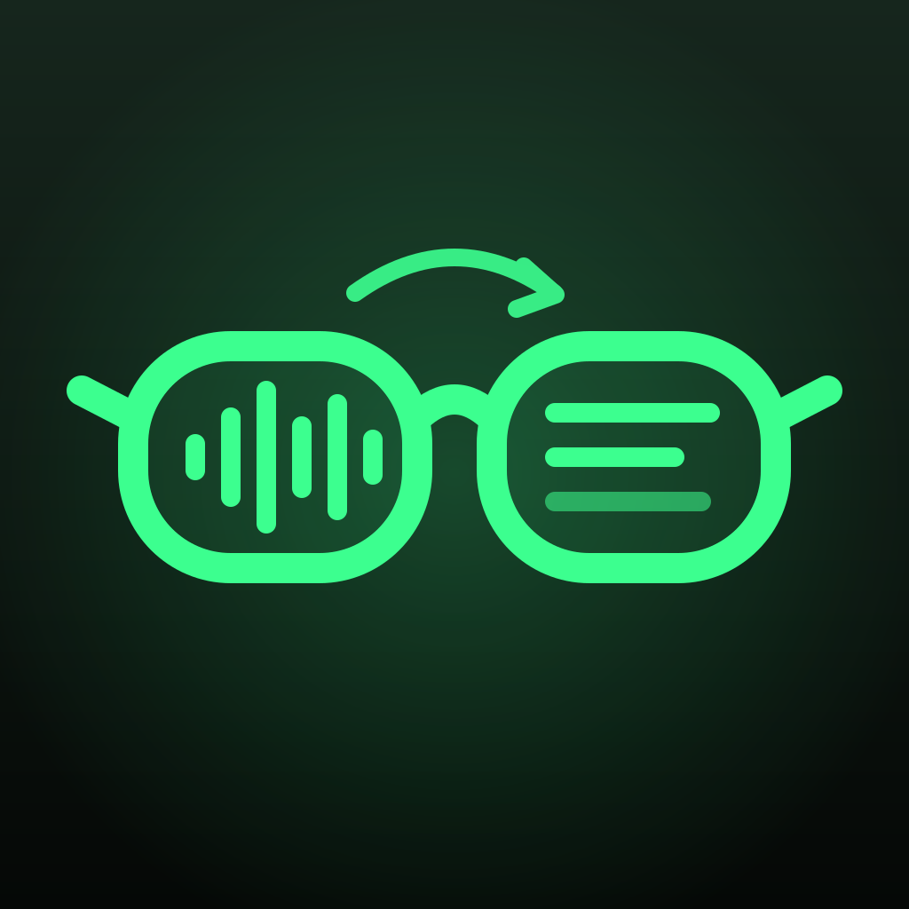

<div align="center">



# Even G1 Live Translator

**Real-time speech translation with ready-to-say replies for Even Realities G1 smart glasses**

[](ios)
[](#-mac-app)
[](LICENSE)
[](https://www.evenrealities.com/g1)
[](https://github.com/Thominho/even-g1-translator/stargazers)

⭐ *Found it useful? A star helps others discover it – thank you!*

**🇬🇧 English** · [🇨🇿 Čeština](README.cs.md) · [🇸🇰 Slovenčina](README.sk.md) · [🇩🇪 Deutsch](README.de.md) · [🇪🇸 Español](README.es.md)<br>
[🇫🇷 Français](README.fr.md) · [🇮🇹 Italiano](README.it.md) · [🇵🇹 Português](README.pt.md) · [🇵🇱 Polski](README.pl.md) · [🇳🇱 Nederlands](README.nl.md)

</div>

---

Someone speaks to you in a language you don't know. Your **Even Realities G1** glasses show a **live
translation**, tell you **which language** it is and, as soon as the speaker finishes, offer **three
ready-to-say replies in their language** with a pronunciation guide. Read one aloud and the glasses
suggest what to **ask back**. Want to say something else? **Say it in your own language** and see it
translated. The phone stays in your pocket.

<p align="center"></p>

## Contents

- [Features](#features)
- [How it works](#how-it-works)
- [📱 iPhone app](#-iphone-app) – recommended
- [Controls](#controls)
- [Choosing your language](#choosing-your-language)
- [💻 Mac app](#-mac-app)
- [Costs and privacy](#costs-and-privacy)
- [Troubleshooting](#troubleshooting)
- [Project structure](#project-structure)
- [Contributing](#contributing)

## Features

- 💬 **Live translation** sentence by sentence, with the conversation so far as context.
- 🏷️ **Language label** on the first sentence.
- ✅ **Three replies on one screen** when the speaker finishes – *yes*, *polite no*, *follow-up question* (or "could you repeat that more slowly?").
- 🗣️ **Pronunciation written for you** – spelled the way your own language reads it.
- 🔁 **Keeps the conversation going** – after you answer, the glasses suggest what to ask back (*"And you?"* plus two sensible questions).
- 🎙️ **Say anything** – hold the left TouchBar, say it in your language, see it in theirs with pronunciation.
- 🙌 **Hands-free** – everything appears on its own; gestures are optional.
- 🎧 **Smart microphone** – listens with the G1 glasses *and* the iPhone and uses whichever hears the speaker better, with automatic gain. The phone can stay in your pocket.
- ⚡ **Fast** – replies and follow-up questions are prepared in the background, so they appear the moment the speaker stops.
- 🙊 **Recognises you** – your own language is never translated, and the app knows when you read a suggestion aloud.
- 🌍 **Your language** – translations, pronunciation and glasses labels in en, cs, sk, de, es, fr, it, pt, pl, nl; app interface in the same 10 languages.

## How it works

<p align="center"></p>

The glasses are a display and microphones – the phone does the thinking. Speech is turned into text
on the phone (iOS speech recognition) or the Mac (Whisper); translations, replies and pronunciation
come from the **Claude API** (Claude Haiku by default – fast and inexpensive). The app talks to the G1
directly over **Bluetooth LE**, following Even Realities' official
[EvenDemoApp](https://github.com/even-realities/EvenDemoApp) protocol.

## 📱 iPhone app

Native SwiftUI app in [`ios/`](ios) – everything runs on the iPhone, no computer needed while you use it.

**Install** (once, needs a Mac with Xcode – a free Apple ID is enough):

```bash
brew install xcodegen
git clone https://github.com/Thominho/even-g1-translator.git
cd even-g1-translator/ios && xcodegen && open G1Translator.xcodeproj
```

In Xcode: **Signing & Capabilities** → pick your **Team** (your Apple ID) and a unique **Bundle Identifier**,
select your iPhone and press **▶ Run**. On the iPhone, trust the developer certificate
(*Settings → General → VPN & Device Management*) and enable *Developer Mode*.

> With a free Apple ID the app runs for **7 days** – then connect the iPhone and press Run again.

**First start** – open *Settings* in the app:

| Setting | |
|---|---|
| They speak | The conversation language (iOS recognition needs it chosen in advance) |
| Your language | Translations, pronunciation and glasses labels |
| App language | Interface language – English by default, 10 languages |
| API key | From the [Anthropic Console](https://console.anthropic.com); the model list loads automatically, Claude Haiku preselected |
| Microphone | **Automatic** (best of glasses and iPhone), G1 glasses, or iPhone / AirPods |
| Better recognition (online) | Apple's server recognition – more accurate in noise, needs internet |

Then **close the Even Realities app** (the G1 accepts one connection at a time), put the glasses on and tap **Start**.

## Controls

<p align="center"></p>

Looking up shows the suggestions again. In the iPhone app the same actions are available as buttons.

## Choosing your language

Set **Your language** (iPhone) or `native_language` (Mac). Everything follows it:

| | What changes |
|---|---|
| Translation | Everything is translated into your language |
| Ignored speech | Your own language is never translated |
| Pronunciation | Spelled for you – an English speaker sees `see, meh GOOS-tah`, a Czech speaker `sí, me gusta` |
| Say it | You dictate in your language |
| Glasses labels | en, cs, sk, de, es, fr, it, pt, pl, nl (others fall back to English) |

Missing your language? Add it in [`g1preklad/i18n.py`](g1preklad/i18n.py) and [`ios/G1Translator/I18n.swift`](ios/G1Translator/I18n.swift) – pull requests welcome.

## 💻 Mac app

The original Python version – runs on a Mac with Bluetooth and recognises the language automatically (Whisper).

```bash
git clone https://github.com/Thominho/even-g1-translator.git && cd even-g1-translator
python3 -m venv .venv && source .venv/bin/activate
pip install -e . && pip install mlx-whisper      # Intel Mac: pip install faster-whisper
cp config.example.toml config.toml                # defaults: Claude API with Claude Haiku
export ANTHROPIC_API_KEY="..."
python -m g1preklad demo "¿Te gusta vivir en Paraguay?"   # test without a microphone
python -m g1preklad run --sim                            # simulated display in the terminal
python -m g1preklad run                                  # with the glasses
```

Key settings in `config.toml`: `native_language`, `replies`, `follow_up_questions`, `reply_layout`,
`turn_end_s`, `prefetch_replies`, `[stt] backend`, `[llm] backend` (`anthropic`, `openai`, or `ollama`
for fully offline use). See [`config.example.toml`](config.example.toml).

## Costs and privacy

| Part | Where | Cost |
|---|---|---|
| Speech → text | On the iPhone / Mac (online recognition optional) | Free |
| Translation, replies | Claude API (Claude Haiku) | Fractions of a cent per sentence |
| Fully offline (Mac) | Whisper + [Ollama](https://ollama.com) | Free, lower quality |

Only text is sent to the API – no audio is stored. The API key is kept in the iOS Keychain.

## Troubleshooting

| Problem | Fix |
|---|---|
| Glasses not found | Close the Even Realities app; take the glasses out of the case |
| Speaker hard to understand | Microphone → *Automatic* or *iPhone*, turn on *Better recognition (online)* |
| Suggestions too early / late | Adjust *Pause before replies* |
| Lines wrap oddly | Adjust *Characters per line* |
| App stopped working after a week | Free Apple ID limit – press ▶ Run in Xcode again |

> **Status:** early release – builds and runs on iPhone; testing with real glasses in everyday use is ongoing.
> Bug reports are very welcome.

## Project structure

| Path | |
|---|---|
| [`ios/`](ios) | iPhone app (SwiftUI): G1 Bluetooth, glasses microphone (LC3 via Google liblc3), speech recognition, Claude API |
| [`g1preklad/`](g1preklad) | Mac app (Python): protocol, glasses, audio, Whisper, LLM backends |
| [`tests/`](tests) | Python tests without hardware: `python -m pytest` |
| [`docs/`](docs) | Illustrations |

## Contributing

Issues and pull requests are welcome – especially reports from real-world use, more languages, and an Android version.

## ⭐ Support the project

If this project helped you understand someone, or saved you an awkward moment abroad,
**please consider giving it a star** – it helps others find it. Thank you in advance! 🙏

## License

[MIT](LICENSE) · LC3 decoder: Google liblc3 (Apache 2.0)

*Not affiliated with or endorsed by Even Realities. "Even Realities" and "G1" are trademarks of their respective owner.*
